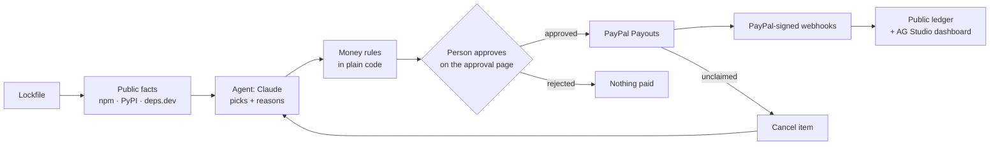

# Pay It Upstream

> **In the vibe-coded era, nobody reads the dependency tree. Agents do. With "Pay It Upstream" in your CLI or AI assistant, agents propose which maintainers to fund, you approve, PayPal pays them.**

**Live (PayPal sandbox):** [pay-it-upstream.ienv.site](https://pay-it-upstream.ienv.site) · [dashboard](https://pay-it-upstream.ienv.site/dashboard) · [signed event log](https://pay-it-upstream.ienv.site/proof) · [for maintainers](https://pay-it-upstream.ienv.site/maintainers)

**Built with:** PayPal Payouts, Orders v2 and webhooks (sandbox) · Claude (Anthropic API) · MCP · AG Studio · TypeScript, Node, Next.js on Cloudflare Workers + D1

## Why

AI coding agents (like Claude Code or Codex) now write much of our code, and often build whole apps for us. They also install the packages those apps run on, and people rarely check what got pulled in. The dependency tree has become something only AI agents read.

Somewhere in that tree are small packages kept alive by one unpaid maintainer, with issues piling up. Nobody notices them until something breaks or a security issue surfaces. Even our small sample app installs **113 packages; a person chose 12 of them**.

So if AI agents are the ones reading the dependency tree, they should help decide who to fund. Pay It Upstream lets them do that research, and keeps a person in charge of the money.

## What it does

```bash
pay-it-upstream --budget 500        # or ask your AI assistant: "fund our dependencies with $500"
```

1. **The agent researches.** It reads the lockfile (`package-lock.json`, `uv.lock`, `requirements.txt`), gathers public facts on each package, and decides where money **protects you most**: packages you rely on that are fragile and underfunded, not the most popular ones. It skips gamed, slopsquatted and prompt-injecting packages, and explains every pick.
2. **Code guards the money.** Budget, at most 30% per package, a $5 minimum, payees only from emails published in the registry. The agent can tighten these, never loosen them.
3. **A person approves.** The plan waits on an approval page. Only the approver passphrase moves it forward, and the agent never has it.
4. **PayPal pays.** One **PayPal Payouts** batch, one payout per maintainer email. Maintainers don't need a PayPal account first. Unclaimed payouts are cancelled and the agent re-splits the money.
5. **PayPal proves it.** A public ledger shows every payment, and a status changes only when a PayPal-signed webhook confirms it.



## Judges: start here

**No login or install needed:**
- [Live site](https://pay-it-upstream.ienv.site): each run shows the agent's picks, reasons and evidence, the packages it skipped and why, who approved it, and the PayPal status of every payout.
- [Signed event log](https://pay-it-upstream.ienv.site/proof): every status comes from a PayPal webhook whose signature was verified.
- [Dashboard](https://pay-it-upstream.ienv.site/dashboard): AG Studio with a Claude-powered assistant. Ask it "why was this package paid?" about any package in the payouts grid.

**Check the code without any keys:**

```bash
git clone https://github.com/apple171/pay-it-upstream && cd pay-it-upstream
npm install && npm test        # money rules, human approval, PayPal webhook signatures
```

**Run it yourself** (about 2 minutes; a free PayPal sandbox app with Payouts enabled and an Anthropic API key):

```bash
npm install -g https://github.com/apple171/pay-it-upstream/tarball/main
cd examples/sample-node-app
pay-it-upstream setup
pay-it-upstream --budget 50 --planted planted-packages.json
```

The agent proposes a plan and skips the three planted test packages (gamed downloads, a slopsquat, and a README with hidden instructions for AI agents). You approve at the printed link, or in the terminal if no site is connected, and PayPal sandbox pays. Sandbox only: no real money moves, and real maintainers are replaced by sandbox test accounts.

**Where to look in the code:**

| What | Where |
|---|---|
| The agent's instructions (public) | [`methodology/agent-prompt.md`](methodology/agent-prompt.md) |
| The agent loop and its tools | [`src/agent/agent.ts`](src/agent/agent.ts) |
| Money rules, enforced in code | [`src/plan.ts`](src/plan.ts) |
| Human approval | [`src/approval.ts`](src/approval.ts), [`web/app/api/approvals`](web/app/api/approvals), [`web/app/approve`](web/app/approve) |
| PayPal Payouts, cancel, re-split | [`src/payout-run.ts`](src/payout-run.ts), [`src/paypal/payouts.ts`](src/paypal/payouts.ts), [`src/cli.ts`](src/cli.ts) |
| Pledges (Orders v2) | [`src/pledges.ts`](src/pledges.ts) |
| Webhook signature check | [`web/lib/paypal-webhook.ts`](web/lib/paypal-webhook.ts) |
| MCP server | [`mcp/server.ts`](mcp/server.ts) |
| AG Studio dashboard | [`web/app/dashboard`](web/app/dashboard) |
| Tests | [`test/`](test/) |

## Get started

Requires Node.js 22+, a PayPal sandbox REST app ([developer.paypal.com](https://developer.paypal.com/dashboard/applications/sandbox)) with Payouts enabled, and an Anthropic API key. It installs straight from GitHub today (the compiled code is in the repo, so there is no build step); the npm release comes next.

```bash
npm install -g https://github.com/apple171/pay-it-upstream/tarball/main     # or prefix each command with: npx github:apple171/pay-it-upstream
cd your-app
pay-it-upstream setup          # model + key, PayPal account, approver passphrase (asks in your terminal)
pay-it-upstream --budget 500   # scan, propose, wait for approval, pay
pay-it-upstream status         # setup, latest run, who has been paid
pay-it-upstream web            # open the site
```

| Command | What it does |
|---|---|
| `setup` | Guided setup. Settings go in `.pay-it-upstream/settings.env`, which is kept out of git automatically |
| `model` / `model set` | Show or change the AI model (Claude Opus, Sonnet, Haiku; Gemini; any local model) and its key |
| `paypal` / `paypal set` | Show or change the PayPal account that pays, and check the keys with PayPal |
| `approver` / `approver set` | Connect the approval site and set the approver passphrase (only a hash is stored) |
| `rules` / `rules set "..."` | Your funding rules in plain English, e.g. "Prefer security-critical packages" |
| `--budget N` | The main command: plan, approval, PayPal payouts, status |
| `status`, `resplit`, `web` | Who has been paid; re-split unclaimed money; open the site |
| `--security-fix`, `--request-feature`, `pledges` | Pledges |

Without a connected site, the approval happens in your terminal instead (`[y/N]`).

## How we use PayPal

All in the free PayPal sandbox.

| Feature | How it is used |
|---|---|
| **Payouts API** (`/v1/payments/payouts`) | One batch per run, one item per package. `sender_batch_id` is derived from the run id, so a re-run can't pay twice |
| **Payout item cancel** (`/v1/payments/payouts-item/{id}/cancel`) | Unclaimed payouts are cancelled before the money is re-split |
| **Orders API, authorize and capture** (`/v2/checkout/orders` with `intent: AUTHORIZE`, `/v2/payments/authorizations/{id}/capture` and `/void`) | Pledges: the payer approves a hold once in PayPal; it is captured when the work ships (and paid out to the maintainer with Payouts) or voided if not. PayPal drops an untouched hold after about 29 days |
| **Payout webhooks** (`PAYMENT.PAYOUTS-ITEM.*`, `PAYMENT.PAYOUTSBATCH.*`) | Drive every status on the public ledger |
| **Payment webhooks** (`PAYMENT.AUTHORIZATION.CREATED`, `.VOIDED`, `PAYMENT.CAPTURE.COMPLETED`) | Confirm each pledge's hold, collection and release on the ledger |
| **Webhook signature verification** | Offline check: SHA256withRSA over `transmissionId\|time\|webhookId\|crc32(body)`, certificate fetched only from `paypal.com` |
| **OAuth 2.0 client credentials** | Server-to-server auth for all calls |

## How we use AI

### Claude: the funding agent

**Anthropic Claude** (default `claude-opus-5-5`) runs as an agent with tools, not a single prompt:

- **Goal:** "spend $500 where it protects us most", plus the company's plain-English rules.
- **Tools:** `inspect_package` (README and full facts for one package) and `submit_plan`.
- **Output:** weights, reasons, evidence, and skipped packages with the reason for each.
- **Agent-era checks:** OpenSSF Scorecard's Code-Review and Maintained checks (is a person accountable?), slopsquatting patterns, and READMEs treated as untrusted data (prompt injection is flagged, never followed).
- **Plain code decides the money:** the AI proposes weights; code turns them into whole dollars within the limits. It can make limits stricter but never looser.
- **A person approves** before anything is paid.
- **Follow-ups:** after unclaimed payouts it plans the re-split.

Its full instructions are public in [`methodology/agent-prompt.md`](methodology/agent-prompt.md), and each run records a fingerprint of the method and the company's rules. The model is swappable (`pay-it-upstream model set`): Claude, Gemini, or any local model. Replies are cached in `.pay-it-upstream/ai-cache`, so re-running the same input costs nothing.

### MCP: for AI assistants and coding agents

[`mcp/`](mcp/) is an MCP server, so the agent that installs a package can fund it. The agent scans the lockfile, decides with its own judgment, and proposes a plan (limits enforced in code). It gets back an **approval link** for the user, not a code it could pass itself. Once a person approves there, `send_payouts` pays with PayPal Payouts. Tools: `scan_dependencies`, `propose_funding`, `send_payouts`, `payout_status`. Setup in [mcp/README.md](mcp/README.md).

### AG Studio: the dashboard

The [dashboard](https://pay-it-upstream.ienv.site/dashboard) runs on **AG Studio** over the live ledger: KPIs, a payouts grid, and three custom widgets (payout timeline, reliance-vs-fragility risk quadrant, critical-packages meter). We wrote a Claude adapter so Studio's AI agents run on Claude, and added our own **"Payout explainer"** agent that answers "why was this package paid?" from the ledger's stored reason, evidence and PayPal-signed status history. The browser never sees the API key: [`web/app/api/ai/claude`](web/app/api/ai/claude/route.ts) pins the model, puts a fixed guard prompt first, and caps usage per visitor and per day.

## What makes it different

- **Agents first, people approve.** The research is the agent's job; the decision is a person's. A plan the agent proposed can only be approved with a passphrase it never sees, and the payout code refuses anything without an approval on record.
- **Risk-weighted, not popularity-weighted.** On the sample app, a download ranking and the agent agree on only 1 of 10 packages. The agent funds the one-maintainer packages under your web server that haven't had a release in years, with a reason and the facts behind each.
- **Built for agent-era risks.** Accountable-human checks, slopsquatting, and prompt injection in READMEs, with planted test packages for each.
- **Unclaimed money doesn't vanish.** If a maintainer has no PayPal account the payout waits; `resplit` cancels it and the agent moves the money to the next package.
- **Proof, not promises.** The ledger only trusts PayPal-signed webhooks. Forged or tampered messages are refused and counted.
- **Your PayPal account, your money.** Payouts go from the company's own PayPal account. Pay It Upstream never holds funds; pledge holds sit on that same account.
- **Also: pledges.** `--security-fix` / `--request-feature` hold money with PayPal toward a specific fix; it goes to the maintainer when the work ships, or is released.

## Signals

| Signal | From |
|---|---|
| **Reliance:** direct vs transitive, how many of your packages need it, ecosystem-wide dependents | your lockfile, [deps.dev](https://deps.dev) |
| **Fragility:** maintainer count, release history, security advisories, OpenSSF Scorecard, deprecation | npm / PyPI registries, deps.dev |
| **Accountable human:** Scorecard Code-Review and Maintained checks | deps.dev |
| **Underfunding:** declared funding links, project size | npm / PyPI metadata, deps.dev |

Dependency data from deps.dev is licensed CC-BY 4.0.

## Run it from a clone (sandbox)

From a clone, Node 22.18+ runs the TypeScript source directly:

```bash
npm install
npm test                        # money rules, approval, webhook signatures
cp .env.example .env            # fill in PayPal sandbox keys and ANTHROPIC_API_KEY
node src/cli.ts plan examples/sample-node-app --budget 500 --env .env
node src/cli.ts pay latest --dir examples/sample-node-app --env .env
node src/cli.ts status latest --dir examples/sample-node-app --env .env
node src/cli.ts resplit latest --dir examples/sample-node-app --env .env
```

- In sandbox, real maintainers are replaced by the test accounts in `SANDBOX_STAND_INS`. Maintainers beyond that list get an address with no PayPal account, so you can watch "waiting to claim" and the re-split.
- `--planted examples/sample-node-app/planted-packages.json` adds three fictional test packages: one with gamed download numbers, one that looks slopsquatted, and an established-looking one whose README hides instructions telling AI agents to give it the whole budget. The agent skips all three, with the reason ("prompt injection in README" for the last); they are labelled in the output.
- `--rules "No package over $80. Only fund our direct dependencies."` adds company rules. The agent turns them into exact limits, and plain code enforces them.

### Pledges

```bash
node src/cli.ts --security-fix debug --amount 100 --note "Fix for the reported ReDoS" examples/sample-node-app --env .env
node src/cli.ts pledges --dir examples/sample-node-app --env .env
node src/cli.ts shipped latest --dir examples/sample-node-app --env .env    # collect the hold, pay the maintainer
node src/cli.ts withdraw latest --dir examples/sample-node-app --env .env   # or release it; nothing is charged
```

The package must be in the project's lockfile and publish a maintainer contact. The CLI prints a PayPal link; whoever funds the pledge approves the hold there, and the CLI places it as soon as they do. The hold is made to your own PayPal account, so you can always release it; when the work ships, the same amount goes to the maintainer with Payouts.

### Ledger web app

```bash
cd web
npm install
cp .env.example .env.local      # PAYPAL_WEBHOOK_ID, LEDGER_PUBLISH_TOKEN
npm run dev
```

Point a PayPal sandbox webhook at `https://<your-host>/api/webhooks/paypal` (payout item and batch events). Then set `LEDGER_URL` and `LEDGER_PUBLISH_TOKEN` for the CLI, and every paid run is published, with maintainer contacts masked.

**Deploy to Cloudflare Workers** (free tier; the ledger is stored in D1):

```bash
cd web
npx wrangler login
npx wrangler d1 create pay-it-upstream     # paste the database_id into wrangler.jsonc
npx wrangler secret put PAYPAL_WEBHOOK_ID
npx wrangler secret put LEDGER_PUBLISH_TOKEN
npx wrangler secret put ANTHROPIC_API_KEY   # optional: enables the dashboard assistant
npm run deploy
```

The dashboard assistant is capped per visitor and per day (`AI_IP_DAILY_LIMIT`, `AI_DAILY_LIMIT`, `AI_TOTAL_LIMIT`).

## What's next

- **Monthly mode.** A scheduled GitHub Action that runs the CLI each month on a fixed budget, so funding keeps up with the lockfile.
- **Log in with PayPal for maintainers.** Lets a maintainer confirm where payments should go, instead of relying only on the registry email.
- **Monthly statements.** A per-company summary built from PayPal Transaction Search: what was paid, claimed, returned and re-split.
- **Pool mode.** A team or community pools money in an organizer's own PayPal account (via invoices or subscriptions) and the agent splits it across shared dependencies.
- **More ecosystems.** pnpm and Yarn lockfiles, Poetry, Cargo and Go modules.
- **Maintainer updates.** Optional email when a payment or pledge is waiting, and a "pitch your package" note maintainers can add for the agent to read.
- **npm release.** Publish the CLI to npm, so `npx pay-it-upstream` works without the `github:` prefix. A two-minute step after the first round of feedback.
- **Log in with PayPal for approvers.** Tie each approval to a PayPal identity instead of a shared passphrase.

## Project layout

```
src/            CLI: setup, lockfiles, signals, agent, money rules, approval, PayPal client
methodology/    the agent's public instructions
examples/       sample Node and Python projects (+ a planted test package)
mcp/            MCP server: lets a coding agent scan, propose and (after approval) pay
web/            public site: approval pages, PayPal webhooks, ledger, AG Studio dashboard
test/           money rules, approval and webhook signature checks (npm test)
```

## License

MIT. See [LICENSE](LICENSE).
